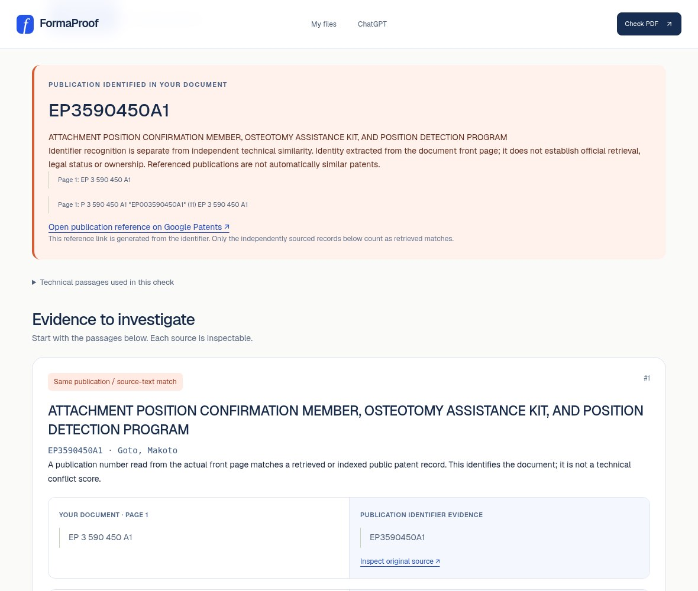

<div align="center">

# PatentRadar · FormaProof

### Find the evidence behind your idea.

**Technical documents. Patent research. Measured 3D design.**

An open-source workspace to explore what already exists, inspect the sources,<br>
and make a better-informed next move.

[**Try the app**](https://patentradar-puce.vercel.app/spot) &nbsp; · &nbsp; [**Watch the workflow**](https://patentradar-puce.vercel.app/demo) &nbsp; · &nbsp; [**Explore a real patent case**](https://patentradar-puce.vercel.app/demo/patent)

[Apache 2.0](LICENSE) &nbsp; · &nbsp; [Node.js 24+](https://nodejs.org/) &nbsp; · &nbsp; [TypeScript](https://www.typescriptlang.org/)

</div>



<p align="center"><sub>Actual application, using the bundled public evaluation PDF. Reference-index mode; external publication verification is off.</sub></p>

## What is PatentRadar?

You have a technical idea, a specification or a drawing. **What has already been published—and which details actually connect to your design?**

PatentRadar helps you investigate that question. Start with a readable PDF or a description, identify related publications, and inspect the passages behind each match. For physical projects, explore measured components in the browser, then take their reviewed functions into patent research.

The web application is called **FormaProof**. This repository keeps the **PatentRadar** name. You can use the application directly; the API, SDK and ChatGPT/MCP connection are optional integrations.

## Why it matters

Building something takes time. Discovering relevant prior work early can help you understand a field, question an assumption or prepare a more focused conversation with an expert.

A search result alone is not enough. You need to know **why it appeared, what the source says and what the search missed**. PatentRadar puts those details beside your technical work, so the next decision is based on evidence you can inspect.

## One project, several ways to work

| Start here | What you can do |
| --- | --- |
| **[Check a document](https://patentradar-puce.vercel.app/spot)** | Upload a readable PDF or describe a design. Identify publication references and inspect technical overlap with sourced passages. |
| **[Research an invention](https://patentradar-puce.vercel.app/workspace)** | Explore patent and scientific records, compare available evidence and follow source links. Coverage and provider failures stay visible. |
| **[Explore measured 3D parts](https://patentradar-puce.vercel.app/engineering)** | Edit supported dimensions, compose assemblies, inspect geometry and import/export STEP or STL. |
| **[Keep your project together](https://patentradar-puce.vercel.app/files)** | Save documents, components and research in private projects; export findings with references and limitations. |
| **[Connect your own tools](https://patentradar-puce.vercel.app/developers)** | Use HTTP, the SDK or MCP. Query one public source with explicit consent, or connect the public tools to ChatGPT. |

Saved research also supports explainable similarity signals and watch checks you run on request. Automated background/email delivery is not enabled.

## Try the workflow

1. **Bring your starting point.** Upload a technical PDF, describe your invention or enter measured specifications.
2. **Review the details.** Check features, dimensions and source passages before searching or building.
3. **Investigate the connections.** Open related records, compare available evidence or explore supported geometry.
4. **Keep what matters.** Save the project, export your findings and return to the design with better questions.

The **[real patent case](https://patentradar-puce.vercel.app/demo/patent)** connects publication **US20080003142A1**, an editable example design and an inspectable technical-overlap signal. [Read the provenance](docs/PATENT_SIMILARITY_ALERTS.md).

## Know the scope

SPOT currently compares against **18 real medical patent publications**, with optional exact EP publication verification. Broader research uses separate providers with varying coverage and access requirements.

A missing result does **not** mean no patent exists. Similarity does **not** determine infringement, patentability or freedom to operate. Missing dimensions are not inferred as verified measurements, and a valid 3D model is not manufacturing certification.

[Reference corpus](docs/MEDTECH_REFERENCE_CORPUS.md) · [Provider coverage](docs/discovery/COVERAGE.md) · [Full feature inventory](docs/FEATURES.md)

## Run it locally

**Node.js 24+** and npm are required.

```bash
git clone https://github.com/medhiblk/patentradar.git
cd patentradar
npm ci
npm run dev
```

Open **[localhost:3000](http://localhost:3000)**. No account, AI key or cloud database is needed for keyless document checks and browser CAD. Installation prepares the self-hosted PDF reader and CAD assets.

[Open in GitHub Codespaces](https://codespaces.new/medhiblk/patentradar) · [Full setup and deployment guide](docs/DEVELOPMENT.md)

<details>
<summary><strong>Configuration, privacy and development checks</strong></summary>

Optional AI interpretation, authenticated providers and cloud storage need configuration. Use `apps/web/.env.example` as a reference; keep credentials out of Git. AI processing requires explicit consent.

Local accounts and files live in `apps/web/.data/` by default. Keep that directory on persistent storage when needed. Production private documents are not included in the repository. [Storage guide](docs/PRIVATE_STORAGE.md).

```bash
npm run typecheck
npm run lint
npm test
npm run check:sdk
npm run build
npm run check:private-build
```

Browser and native CAD test prerequisites are in the [development guide](docs/DEVELOPMENT.md).

[](https://github.com/medhiblk/patentradar/actions/workflows/ci.yml)

</details>

## Built with

**TypeScript · Next.js · React · OpenCascade WASM · SQLite**

The npm monorepo contains the web application, shared contracts, engineering logic and SDK. Python/CadQuery is an optional native worker. The static GitHub Pages introduction is separate from the server-backed application.

[Architecture](docs/MONOREPO.md) · [Engineering workbench](docs/engineering/WORKBENCH.md) · [Source-query API](docs/SOURCE_QUERY.md) · [API & MCP](docs/API_MCP.md)

## Contribute

Help make the evidence easier to inspect: report a reproducible bug, improve document handling or accessibility, test measured geometry, or add a source adapter with documented provenance. Use non-confidential examples and run the relevant checks before submitting changes.

[Open an issue](https://github.com/medhiblk/patentradar/issues) · [Implementation status](docs/IMPLEMENTATION_STATUS.md) · [Branch analysis](docs/BRANCH_ANALYSIS.md)

---

Licensed under **[Apache 2.0](LICENSE)**. Third-party attribution: [NOTICES.md](NOTICES.md).
