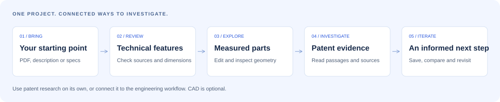

# PatentRadar · FormaProof

### Understand your idea. Explore the design. Investigate the evidence.

PatentRadar is an open-source research and engineering workspace for people turning technical ideas into projects. Bring a document, describe an invention or start with measured specifications. Review the technical features, investigate related patent publications, and explore editable 3D components where the available dimensions support them.

The goal is to connect **what you want to build** with **what you can understand, model and verify**—while keeping the original sources and remaining uncertainties visible.

**FormaProof** is the application’s working name. **PatentRadar** remains the repository name and API/MCP identity.

[**Open the app →**](https://patentradar-puce.vercel.app) · [Check a PDF](https://patentradar-puce.vercel.app/spot) · [Try the demo](https://patentradar-puce.vercel.app/demo) · [Explore 3D tools](https://patentradar-puce.vercel.app/engineering) · [Run locally](#quick-start)

[](https://github.com/medhiblk/patentradar/actions/workflows/ci.yml)
[](LICENSE)
[](https://nodejs.org/)



[Why it matters](#why-this-project-matters) · [Features](#features) · [Use cases](#who-it-is-for) · [How it works](#how-it-works) · [Setup](#quick-start) · [Documentation](#documentation)

## Why this project matters

An idea rarely arrives as a complete specification. It might begin as a sketch, a technical manual, a research paper or a problem someone wants to solve. Turning that starting point into a project means answering several connected questions:

- **What does the system actually do?** Identify components, functions and relationships before relying on an interpretation.
- **Can the design be represented with the measurements available?** Explore geometry without treating missing dimensions as facts.
- **What has already been published?** Investigate earlier technical approaches and inspect the evidence behind apparent similarities.
- **What should we investigate next?** Keep documents, design parameters and research together so findings can inform the next iteration.

These questions matter before a team commits time and money to development. Patent publications can reveal useful technical knowledge and earlier approaches. A measured model can help make an abstract description easier to inspect. Neither is sufficient on its own: a similar title does not establish a legal conflict, and a valid solid model does not establish a manufacturable product.

PatentRadar brings document understanding, engineering exploration and source-aware research into one workspace. It helps users prepare better technical discussions and more focused questions for domain experts or patent professionals.

## Who it is for

| User                                   | Example starting point                            | Useful next step                                                                |
| -------------------------------------- | ------------------------------------------------- | ------------------------------------------------------------------------------- |
| **Engineers and product teams**        | A manual, specification or measured component     | Review features, explore an assembly and investigate related technologies.      |
| **Inventors and early-stage founders** | A written description of a proposed solution      | Explore earlier publications and prepare a sourced research brief.              |
| **Researchers and students**           | A technical document or an unfamiliar field       | Follow patent and literature sources, compare terminology and inspect evidence. |
| **Developers and tool builders**       | A workflow that needs research or component tools | Use the HTTP API, shared packages, SDK or MCP integration.                      |

General patent research is available independently of the mechanical design tools.

## Features

### Document understanding and first checks

- Upload technical PDFs with a readable text layer or describe an invention in your own words.
- Review extracted technical features and, where supplied, source pages, quotations and measurements.
- Use **SPOT** to identify publication references and compare technical content with the attributed reference index.
- Distinguish a recognized publication, reproduced publication text and technical-term overlap.
- Use optional AI-assisted interpretation when configured and explicitly approved; local extraction remains available without an AI key.

[Check a document](https://patentradar-puce.vercel.app/spot) · [Document handling](docs/PDF_UPLOAD_RECOVERY.md)

### Patent and scientific research

- Search configured public sources for patent publications and relevant scientific literature.
- Follow progressive results and inspect provider responses, empty results and failures.
- Review duplicate and family grouping where the source supplies the necessary identifiers.
- Explore available citations, applicants and jurisdictions within the returned sample.
- Compare technical features with actual claims when available, with abstract- or title-only limitations made visible.

Provider access and coverage vary. A returned sample is not a complete technology landscape.

[Search evidence and methodology](docs/SEARCH_EVIDENCE.md) · [Provider coverage](docs/discovery/COVERAGE.md)

### Measured 3D design and iteration

- Build supported components from explicit dimensions using browser-based OpenCascade geometry.
- Edit component dimensions and placement, compose assemblies, and inspect selection, visibility, exploded views and basic motion.
- Work with starter components, source references and custom housings with entered clearances.
- Import or export STEP/STL and retain editable assembly parameters as JSON.
- Transfer reviewed component functions to patent research, then return to the design with the supported same-tab handoff.

Missing dimensions remain missing. Interactive motion is not physical simulation, and geometric validity does not establish manufacturing accuracy. Imported geometry may need to be reselected when returning to the studio.

[Open the 3D studio](https://patentradar-puce.vercel.app/engineering) · [Engineering workflow](docs/engineering/WORKBENCH.md)

### Projects, evidence and reports

- Keep source documents, research and components in private projects.
- Upload, download and delete attachments through authenticated routes.
- Export research PDFs with source references, methodology and limitations.
- Review explainable similarity signals and refresh saved watch checks when requested.
- Use local SQLite/filesystem storage or configure a private Blob backend for an appropriate deployment.

Background monitoring and email delivery are not enabled. Similarity signals are prompts for investigation, not infringement probabilities.

[Projects and files](https://patentradar-puce.vercel.app/files) · [Private storage](docs/PRIVATE_STORAGE.md) · [Similarity alerts](docs/PATENT_SIMILARITY_ALERTS.md)

### APIs and integrations

Query a specific public provider through `POST /api/v1/sources/query`, the MCP `query_source` tool or SDK `querySource()`. Each requires explicit query-sharing consent and returns a source outcome with coverage limits. [Source-query guide](docs/SOURCE_QUERY.md).

The full web application can be used on its own. For other workflows, the project also provides versioned HTTP endpoints, OpenAPI documentation, shared schemas, an integration SDK and a remote MCP server for public research and component inspection. ChatGPT is one supported connection path; it is not required to use the application.

SDK packages can be packed locally and are not currently published npm packages. The public MCP tools do not expose private uploaded files.

[Developer portal](https://patentradar-puce.vercel.app/developers) · [HTTP API & MCP](docs/API_MCP.md) · [ChatGPT connection guide](https://patentradar-puce.vercel.app/connect)

## How it works

1. **Start with what you have.** Open the [workspace](https://patentradar-puce.vercel.app/workspace) with a document or description, use [SPOT](https://patentradar-puce.vercel.app/spot) for a first document check, or go directly to the [3D studio](https://patentradar-puce.vercel.app/engineering).
2. **Review the interpretation.** Check technical features, dimensions and supporting passages. Correct the starting brief before searching or building.
3. **Choose your investigation.** Explore patent evidence, work on supported measured components, or connect the two workflows.
4. **Inspect the output.** Follow source links, review coverage and missing evidence, and check the model against the measurements supplied.
5. **Keep the context.** Save research and attachments, export findings, or revisit the design with a clearer understanding of what to investigate next.

### Try a real patent case

The [US20080003142A1 demo](https://patentradar-puce.vercel.app/demo/patent) connects a verified publication excerpt, an editable example design and an inspectable technical-overlap signal. Follow the original source and see how evidence carries through the workflow.

The example demonstrates an earlier publication and technical overlap. It does not establish an active blocking right. [Read its provenance and limitations](docs/PATENT_SIMILARITY_ALERTS.md).

## Coverage and current limits

| Area                          | Current scope                                                                                                                                 |
| ----------------------------- | --------------------------------------------------------------------------------------------------------------------------------------------- |
| **SPOT reference collection** | 18 real medical patent publications. This bounded index is separate from broader provider-based research.                                     |
| **Broader research**          | Configured sources with varying coverage, availability, credentials and claim access.                                                         |
| **Document reading**          | Readable PDF text is supported. Scans without a text layer need OCR. Image interpretation requires configured AI access and consent.          |
| **Engineering**               | Supported measured geometry and assembly operations; no universal drawing reconstruction, physical simulation or manufacturing certification. |
| **Watch checks**              | User-triggered refresh; no background email delivery.                                                                                         |
| **Legal conclusions**         | No automatic patentability, infringement or freedom-to-operate determination.                                                                 |

**An empty result does not mean that no patent exists.** Technical similarity does not determine whether an idea is legally protected. Claims, jurisdiction, legal status and expert review remain essential.

[Reference corpus and provenance](docs/MEDTECH_REFERENCE_CORPUS.md) · [Functional inventory](docs/FEATURES.md) · [Implementation status](docs/IMPLEMENTATION_STATUS.md)

## Quick start

Requires **Node.js 24+** and npm.

```bash
git clone https://github.com/medhiblk/patentradar.git
cd patentradar
npm ci
npm run dev
```

Open [localhost:3000](http://localhost:3000). Installation prepares the self-hosted CAD and PDF reader assets. No `.env` is required for browser CAD, local storage and keyless checks.

[Open in GitHub Codespaces](https://codespaces.new/medhiblk/patentradar) if you prefer a browser-based development environment.

For a production build:

```bash
npm run build
npm start
```

[Full development guide](docs/DEVELOPMENT.md) covers Docker, browser tests, package checks and deployment configuration.

## Configuration and privacy

- **Optional integrations:** use `apps/web/.env.example` as a reference for AI, authenticated providers and storage. Configure only what you need and keep secrets out of Git.
- **AI processing:** requires configured access and explicit consent. Local extraction is labeled separately from AI-assisted interpretation.
- **Local data:** accounts and files belong to the environment where you create them. The default local store is `apps/web/.data/`; use persistent storage when needed.
- **Cloud data:** production private documents are not cloned from GitHub. A separate development store is recommended for disposable environments.
- **Design handoff:** supported parameters and source references can be retained in the current browser tab. Browser storage is not an authenticated private vault.

[Private storage setup](docs/PRIVATE_STORAGE.md) · [Design handoff and boundaries](docs/product/POSITIONING.md)

## Architecture

The project uses **TypeScript, Next.js, React and npm workspaces**, with OpenCascade WASM for browser CAD and an optional Python/CadQuery worker.

| Location               | Responsibility                                                                                 |
| ---------------------- | ---------------------------------------------------------------------------------------------- |
| `apps/web`             | Web UI, API/MCP routes, research providers, private storage and browser workflows.             |
| `packages/contracts`   | Shared validation schemas and public input/output contracts.                                   |
| `packages/engineering` | Component and assembly schemas, catalog and parametric operations.                             |
| `packages/sdk`         | Typed HTTP client, progressive search and MCP connection utilities.                            |
| `services/cad`         | Optional native Python/CadQuery worker.                                                        |
| `site`                 | Static project introduction prepared for GitHub Pages; server features run in the application. |

[Monorepo and deployment guide](docs/MONOREPO.md) · [Architecture](docs/UX_ARCHITECTURE.md)

## Development checks

Run from the repository root:

```bash
npm run typecheck
npm run lint
npm test
npm run check:sdk
npm run build
npm run check:private-build
```

The repository also includes Playwright browser tests and separate native CAD tests. See [the development guide](docs/DEVELOPMENT.md) for prerequisites and commands. Automated provider mocks do not establish live external-service availability.

## Documentation

| Topic                                      | Guide                                                                                                     |
| ------------------------------------------ | --------------------------------------------------------------------------------------------------------- |
| Getting started, testing and deployment    | [Development guide](docs/DEVELOPMENT.md)                                                                  |
| Capabilities and implementation boundaries | [Feature inventory](docs/FEATURES.md) · [Implementation status](docs/IMPLEMENTATION_STATUS.md)            |
| Source attribution and search behavior     | [Search evidence](docs/SEARCH_EVIDENCE.md) · [Coverage](docs/discovery/COVERAGE.md)                       |
| Reference data                             | [Medical patent corpus](docs/MEDTECH_REFERENCE_CORPUS.md)                                                 |
| Components, geometry and design iteration  | [Engineering workbench](docs/engineering/WORKBENCH.md)                                                    |
| Accounts, projects and attachments         | [Private storage](docs/PRIVATE_STORAGE.md)                                                                |
| API, SDK and MCP                           | [Integration guide](docs/API_MCP.md) · [OpenAPI](https://patentradar-puce.vercel.app/api/v1/openapi.json) |
| GitHub presentation and Pages setup        | [Publication instructions](docs/GITHUB_PRESENTATION.md)                                                   |

[Remote branch analysis and recommended next work](docs/BRANCH_ANALYSIS.md)

## Contributing

Contributions that make the project more useful and its evidence easier to inspect are welcome:

- Report bugs with clear steps and a small, non-confidential example.
- Improve document handling, measured geometry or accessibility.
- Add source adapters with documented provenance and coverage limits.
- Add meaningful tests for incorrect matches, missing evidence and broken workflows.
- Improve documentation and reproducible setup instructions.

Run the relevant development checks before submitting changes. Never include credentials, private documents or account databases in a contribution.

[Report an issue](https://github.com/medhiblk/patentradar/issues) · [Browse the source](https://github.com/medhiblk/patentradar)

## License

Licensed under [Apache 2.0](LICENSE). See [NOTICES.md](NOTICES.md) for third-party licensing information.
